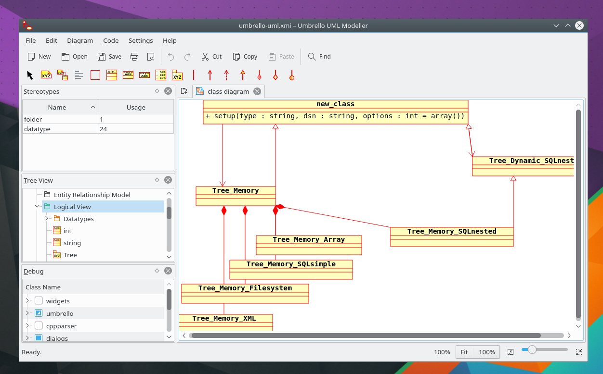
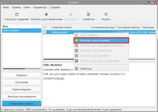

# Umbrello UML Modeling and Source Code Generation

[](https://github.com/siudalia-4626/umbrello-uml/releases/)

Umbrello is a desktop environment for describing software structure, interactions, and deployment through diagrams.
An umbrello uml workflow connects visual design with model storage, source import, and code generation.

## Contents

- [Modeling Workspace](#modeling-workspace)
- [Diagram Types](#diagram-types)
- [Model Files and Exchange](#model-files-and-exchange)
- [Source Import](#source-import)
- [Code Generation](#code-generation)
- [Diagram Export](#diagram-export)
- [Settings and Review](#settings-and-review)

## Modeling Workspace

The umbrello kde application combines a model tree, an editable diagram area, and documentation tools.
Use the tree to navigate model elements and keep related diagrams together.

- Group related elements into logical folders.
- Open the diagram that addresses the current design question.
- Inspect an element's properties when refining its definition.
- Add documentation where a name or relationship needs explanation.

The umbrello uml modeller supports several views of the same system.
A focused diagram is easier to discuss than a single canvas containing every detail.



## Diagram Types

| Diagram | Main question | Example subject |
| --- | --- | --- |
| Class | What types and relationships exist? | Accounts and transactions |
| Use case | Who interacts with the system? | Customer account access |
| Sequence | Which messages occur over time? | A payment authorization |
| Activity | How does a process flow? | Request review |
| State | How does an object change state? | An order lifecycle |
| Component | How are software parts arranged? | Service dependencies |
| Deployment | Where do components run? | Application and database nodes |
| Entity relationship | How is stored data related? | Customer and invoice records |

Choose the notation according to the discussion.
Use separate structural and behavioral views when both are needed.

Communication diagrams are also available.
They offer another way to show collaborating objects and their messages.

## Model Files and Exchange

Umbrello stores models using XMI.
Keep the editable model alongside exported illustrations so later changes can be made from the source model.

- Save the model after meaningful design changes.
- Use descriptive diagram names.
- Retain a previous model copy before a large restructuring.
- Check the result when exchanging XMI with another application.

XMI support does not guarantee that every tool preserves identical extensions or diagram layout.
Test the elements and relationships your exchange actually needs.

> [!TIP]
> Keep one diagram focused on one review question.
> Add another view when a different audience needs a different level of detail.

## Desktop Command Inspection

These commands inspect the installed application's version, language list, and image export formats.
They assume the umbrello executable is available on the command path.

```bash
umbrello --version
umbrello --languages
umbrello --export-formats
```

Use the reported capabilities when preparing automation for a particular installation.
Available packages and build options can vary between systems.

## Source Import

An umbrello uml modeler workflow can begin with existing source code.
Import helps expose class structure for inspection and further modeling.

For example, a C++ header might describe a small domain object:

```cpp
class Invoice {
public:
    void markPaid();
private:
    bool paid = false;
};
```

This original example is ordinary C++ source, not a scripting interface for Umbrello.
Save suitable source in your own project and use the code import tools to inspect the recognized structure.

Import support depends on the language parser and the source constructs involved.
Review the imported classes before using the result as design documentation.

- Check names and visibility.
- Inspect recognized attributes and operations.
- Compare relationships with the source.
- Add design context that source declarations alone cannot express.

## Code Generation

The umbrello code generator can create source declarations from modeled classes.
Generated structures provide a starting point for implementation.

1. Create or load a model containing classes.
2. Select the classes to generate.
3. Choose the target language and destination.
4. Review comment, formatting, and overwrite options.
5. Inspect the resulting source before integrating it.

Generation does not implement the behavior of each operation.
Write and test the application logic in the appropriate development environment.

Existing output needs particular attention.
Choose whether existing files should be overwritten, skipped, or given alternative names.

## Sequence and Interaction Review

Use sequence diagrams when the order of calls matters.
Name the participants and messages so the reader can follow the scenario.

- Show the entry point for the interaction.
- Distinguish calls to another participant from self calls.
- Review nested method calls for readability.
- Check arrow direction and message placement.

A scenario should be understandable without reading unrelated class details.
Move background structure into a separate class or component view.



## Diagram Export

Image export makes diagrams available for reports, reviews, and presentations.
The graphical interface supports exporting individual diagrams or several diagrams together.

The following Bash example exports a model's diagrams to PNG.
The model name is illustrative and must refer to your own existing XMI file.

```bash
mkdir -p review-images
umbrello --export png --directory ./review-images system-model.xmi
ls ./review-images
```

Check the supported export formats before choosing an extension.
The command-line export still uses Qt application infrastructure, so automated environments need suitable Qt runtime support.

The use-folders option can preserve the model's view folder structure in the export destination.
Inspect exported labels and connector positions at the size your readers will use.

## Settings and Review

Adjust fonts, colors, association appearance, and class display options to suit the diagram.
Keep visual conventions consistent across related views.

- Configure autosave and its interval.
- Choose a useful default programming language.
- Review deletion notifications before removing model elements.
- Set startup behavior to match how you resume work.

Autosave supports recovery during editing.
Keep independent copies for longer-term project history.

## Design Handoff

Share the model when another person needs to edit its structure.
Share exported diagrams when the immediate task is discussion or presentation.

Include a short explanation of the scope and assumptions with the handoff.
Record which implementation version the model describes.

- Confirm that each diagram has a clear purpose.
- Review relationships after renaming or moving elements.
- Compare generated declarations with the intended design.
- Keep implementation changes and design revisions aligned.

## Related Search Terms

umbrello uml, umbrello kde, umbrello uml modeller, umbrello uml modeler, umbrello code generator, uml, modeling, diagram, uml-diagram, kde, qt, xmi, code-generation, reverse-engineering, software-design
